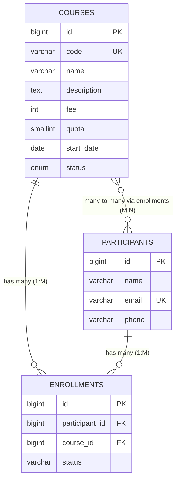

# KursusKu — Laravel

Platform kursus dan pelatihan interaktif berbasis web yang dibangun menggunakan framework Laravel 13. Proyek ini mengintegrasikan arsitektur MVC modern, Blade Templating Engine, Bootstrap 5, jQuery AJAX, basis data MySQL (`kursus_nia`), Eloquent ORM, Form Request Validation, operasi CRUD lengkap, dan Vite asset bundling dengan identitas visual khas **True Pink × Chill White**.

---

## 1. Deskripsi Aplikasi

KursusKu menyajikan katalog kursus pelatihan terarah bagi peserta yang ingin mengembangkan keahlian digital (Teknologi, Desain, Bisnis, dan Perkantoran).

Perjalanan pengembangan aplikasi:
- **Pertemuan 7:** Migrasi dari PHP Native ke Laravel MVC, pemisahan logika controller dan Blade landing page responsif bertema True Pink × Chill White.
- **Pertemuan 9:** Arsitektur Master Layout Blade, reusable responsive navbar Bootstrap 5, form pendaftaran interaktif, validasi form server-side, serta implementasi jQuery AJAX untuk ketersediaan kuota.
- **Pertemuan 10:** Integrasi database MySQL (`kursus_nia`), pembuatan migration tabel `courses`, Eloquent Model `Course` dengan fillable dan casting, Resource Controller (`CourseController`), operasi Create & Read (daftar kursus dan tambah kursus), validasi ketat, pengisian minimal 8 data kursus, serta integrasi endpoint Ajax ketersediaan kuota langsung dari database.
- **Pertemuan 11:** Implementasi Course CRUD lengkap: Halaman Detail (`show`) berbasis Route Model Binding, pemisahan validasi ke Form Request (`StoreCourseRequest` dan `UpdateCourseRequest`), validasi `unique` dinamis menggunakan `Rule::unique()->ignore()`, Halaman Edit & Operasi Update (`update`) dengan method spoofing `PUT`, Operasi Hapus (`destroy`) dengan proteksi CSRF, method spoofing `DELETE`, dan konfirmasi dialog JavaScript, serta umpan balik validasi error di setiap field input.
- **Pertemuan 12:** Relational Database (Course, Participant, Enrollment): Penyusunan ERD, migrasi tabel `participants` dan tabel pivot `enrollments` dengan foreign key constraints (`ON DELETE CASCADE`) dan composite unique index `(participant_id, course_id)`. Relasi Eloquent lengkap (`hasMany`, `belongsToMany` dengan pivot `status` dan timestamps, `belongsTo`), seeding data awal peserta, `EnrollmentController` dengan eager loading `with(['participant', 'course'])`, form relasional dengan dropdown peserta dan filter kursus berstatus open, validasi duplikasi dua lapis, serta halaman laporan pendaftaran relasional responsif bertema True Pink × Chill White.

---

## 2. Kebutuhan Sistem (Requirements)

- **PHP:** >= 8.3 (versi terpasang: PHP 8.3.33)
- **Database Server:** MySQL 8.x / MariaDB (via Laragon)
- **Node.js:** >= 20.x (versi terpasang: Node v22.18.0)
- **NPM:** >= 10.x (versi terpasang: NPM 10.9.3)
- **Composer:** >= 2.2 (versi terpasang: Composer 2.10.2)
- **Framework:** Laravel 13 (v13.43.0)
- **Front-end Libraries:**
  - `bootstrap`: ^5.3.9
  - `@popperjs/core`: ^2.11.8
  - `jquery`: ^4.1.0
- **Bundler:** Vite 8 dengan Laravel Vite Plugin

---

## 3. Konfigurasi Basis Data MySQL (`kursus_nia`)

Database yang digunakan bernama **`kursus_nia`** pada server MySQL lokal (Laragon).

### Pengaturan `.env`
```env
DB_CONNECTION=mysql
DB_HOST=127.0.0.1
DB_PORT=3306
DB_DATABASE=kursus_nia
DB_USERNAME=root
DB_PASSWORD=
```
*(Kredensial password disesuaikan dengan konfigurasi aktual MySQL lokal tanpa mengekspos kata sandi).*

### Karakteristik Database:
- **Encoding / Character Set:** `utf8mb4`
- **Collation:** `utf8mb4_unicode_ci`

---

## 4. Resource Routing Lengkap

Daftar rute courses dan enrollments didefinisikan pada `routes/web.php` melalui:

```php
Route::get('/', [HomeController::class, 'index'])->name('home');
Route::get('/courses/{course}/availability', ...)->name('courses.availability');
Route::resource('courses', CourseController::class);
Route::resource('enrollments', EnrollmentController::class)->only(['index', 'create', 'store']);
Route::get('/pendaftaran', ...)->name('pendaftaran.create');
Route::post('/pendaftaran/preview', ...)->name('pendaftaran.preview');
```

Daftar rute yang aktif:

| Method | URI | Named Route | Action Controller / Handler | Keterangan |
|---|---|---|---|---|
| GET | `/` | `home` | `HomeController@index` | Landing page utama |
| GET | `/courses` | `courses.index` | `CourseController@index` | Menampilkan tabel seluruh kursus |
| GET | `/courses/create` | `courses.create` | `CourseController@create` | Form tambah kursus baru |
| POST | `/courses` | `courses.store` | `CourseController@store` | Menyimpan kursus baru (`StoreCourseRequest`) |
| GET | `/courses/{course}` | `courses.show` | `CourseController@show` | Menampilkan detail lengkap satu kursus |
| GET | `/courses/{course}/edit` | `courses.edit` | `CourseController@edit` | Form edit data kursus |
| PUT/PATCH | `/courses/{course}` | `courses.update` | `CourseController@update` | Memperbarui data kursus (`UpdateCourseRequest`) |
| DELETE | `/courses/{course}` | `courses.destroy` | `CourseController@destroy` | Menghapus data kursus permanen |
| GET | `/courses/{course}/availability` | `courses.availability` | Closure (`routes/web.php`) | Endpoint JSON status & kuota untuk Ajax |
| GET | `/enrollments` | `enrollments.index` | `EnrollmentController@index` | Laporan relasional enrollment dengan eager loading |
| GET | `/enrollments/create` | `enrollments.create` | `EnrollmentController@create` | Form relasional pendaftaran (dropdown participant & open course) |
| POST | `/enrollments` | `enrollments.store` | `EnrollmentController@store` | Menyimpan enrollment baru dengan validasi anti-duplikasi |
| GET | `/pendaftaran` | `pendaftaran.create` | Closure (`routes/web.php`) | Form preview pendaftaran interaktif (Pertemuan 9) |
| POST | `/pendaftaran/preview` | `pendaftaran.preview` | Closure (`routes/web.php`) | Validasi data form pendaftaran preview |

---

## 5. Basis Data Relasional: Course, Participant, & Enrollment (Pertemuan 12)

Sistem mengimplementasikan basis data relasional antara entitas **Course**, **Participant**, dan **Enrollment**:

### Diagram Hubungan Entitas (ERD)
Dokumentasi lengkap ERD tersedia di [`evidence/week-12/erd.md`](evidence/week-12/erd.md).



### Aturan Integritas Referensial & Constraints
1. **Foreign Key dengan `ON DELETE CASCADE`:**
   - Menghapus kursus akan otomatis menghapus record pendaftaran (`enrollments`) yang terkait, tanpa menghapus data peserta (`participants`).
   - Menghapus peserta akan otomatis menghapus record pendaftaran (`enrollments`) yang terkait, tanpa menghapus data kursus (`courses`).
2. **Composite Unique Index:**
   - Pasangan kolom `(participant_id, course_id)` bersifat unik pada level database untuk mencegah duplikasi pendaftaran peserta pada kursus yang sama.
3. **Validasi Dua Lapis (Two-Layer Validation):**
   - **Layer Aplikasi:** `EnrollmentController` menggunakan `Rule::unique('enrollments', 'course_id')->where('participant_id', ...)` dengan pesan kesalahan kustom: *"Participant ini sudah terdaftar pada course tersebut."*
   - **Layer Database:** Composite Unique Key pada schema migration.

### Relasi Eloquent ORM
- **Model `Course` (`app/Models/Course.php`):**
  - `enrollments()`: `hasMany(Enrollment::class)`
  - `participants()`: `belongsToMany(Participant::class, 'enrollments')->withPivot('status')->withTimestamps()`
- **Model `Participant` (`app/Models/Participant.php`):**
  - `enrollments()`: `hasMany(Enrollment::class)`
  - `courses()`: `belongsToMany(Course::class, 'enrollments')->withPivot('status')->withTimestamps()`
- **Model `Enrollment` (`app/Models/Enrollment.php`):**
  - `participant()`: `belongsTo(Participant::class)`
  - `course()`: `belongsTo(Course::class)`

### Eager Loading (Pencegahan Masalah N+1 Query)
Pada `EnrollmentController@index`, pengambilan data relasi menggunakan:
```php
$enrollments = Enrollment::with(['participant', 'course'])->latest()->get();
```
Memastikan eksekusi query tetap konstan dan efisien tanpa melakukan query berulang untuk setiap baris data peserta dan kursus.

---

## 5. Form Request Validation

Validasi request dipisahkan dari controller ke dalam dedicated Form Request classes:

### 1. `StoreCourseRequest` (`app/Http/Requests/StoreCourseRequest.php`)
- `authorize(): true`
- **Aturan Validasi:**
  - `code`: `required|string|max:20|unique:courses,code`
  - `name`: `required|string|min:3|max:120`
  - `description`: `nullable|string|max:2000`
  - `fee`: `required|integer|min:0`
  - `quota`: `required|integer|between:1,500`
  - `start_date`: `required|date`
  - `status`: `required|in:draft,open,closed`

### 2. `UpdateCourseRequest` (`app/Http/Requests/UpdateCourseRequest.php`)
- `authorize(): true`
- **Unique Rule Ignore:**
  Menggunakan `Illuminate\Validation\Rule` agar kode kursus milik record yang sedang diedit tetap sah digunakan (tidak memicu duplicate error pada diri sendiri), namun tetap menolak jika kode tersebut telah digunakan oleh kursus lain:
  ```php
  'code' => [
      'required',
      'string',
      'max:20',
      Rule::unique('courses', 'code')->ignore($this->route('course')),
  ],
  ```
- Seluruh aturan field lainnya (`name`, `description`, `fee`, `quota`, `start_date`, `status`) konsisten dengan `StoreCourseRequest`.

---

## 6. Implementasi CRUD pada `CourseController`

File: `app/Http/Controllers/CourseController.php`

- **`index()`:** Mengambil data terbaru (`Course::latest()->get()`) dan merender view `courses.index`.
- **`create()`:** Menampilkan formulir penambahan kursus `courses.create`.
- **`store(StoreCourseRequest $request)`:** Memvalidasi input via Form Request, menyimpan record (`Course::create($request->validated())`), dan mengalihkan ke `courses.index` dengan flash message sukses *"Kursus berhasil ditambahkan."*.
- **`show(Course $course)`:** Memanfaatkan Route Model Binding untuk mengambil instance model secara otomatis berdasarkan ID di URI, dan merender view `courses.show`. Jika ID tidak ditemukan, Laravel otomatis menghasilkan respon HTTP 404.
- **`edit(Course $course)`:** Menampilkan form edit `courses.edit` dengan data yang sedang tersimpan.
- **`update(UpdateCourseRequest $request, Course $course)`:** Memvalidasi perubahan melalui `UpdateCourseRequest`, memperbarui record (`$course->update($request->validated())`), dan mengalihkan pengguna ke halaman detail `courses.show` dengan flash message sukses *"Kursus berhasil diperbarui."*.
- **`destroy(Course $course)`:** Menghapus record kursus dari basis data (`$course->delete()`), dan mengalihkan ke `courses.index` dengan flash message *"Kursus berhasil dihapus."*.

---

## 7. Tampilan Antarmuka & User Experience (Blade)

### 1. Halaman Index Kursus (`resources/views/courses/index.blade.php`)
- Kolom tabel lengkap: No, Kode, Nama, Biaya, Kuota, Tanggal Mulai, Status, dan **Aksi**.
- Kolom Aksi menyediakan:
  - Tombol **Detail** (`courses.show`)
  - Tombol **Edit** (`courses.edit`)
  - Tombol **Hapus** (`courses.destroy`) via form POST dengan method spoofing `@method('DELETE')` dan dialog konfirmasi JavaScript:
    `onsubmit="return confirm('Hapus kursus ini?');"`
- Jika pengguna memilih *Cancel* pada dialog, form batal dikirim dan data tetap aman. Jika *OK*, request DELETE diproses.

### 2. Halaman Detail Kursus (`resources/views/courses/show.blade.php`)
- Menampilkan rincian komprehensif: Kode, Nama, Badge Status (`open`, `draft`, `closed`), Deskripsi lengkap, Biaya (format `Rp 300.000`), Kuota (`25 Kursi`), Tanggal Mulai (`d/m/Y`), serta waktu pembuatan dan pembaruan data.
- Tombol navigasi: *Kembali ke Daftar Kursus* dan *Edit Kursus*.

### 3. Halaman Edit Kursus (`resources/views/courses/edit.blade.php`)
- Form mengarah ke `route('courses.update', $course)` dengan method POST, `@csrf`, dan `@method('PUT')`.
- Pola input mempertahankan data tersimpan sekaligus mengutamakan input baru saat validasi gagal:
  `old('field', $course->field)`
- Format tanggal diatur menggunakan format ISO standar `Y-m-d` (`$course->start_date->format('Y-m-d')`).
- Pilihan status mempertahankan seleksi tersimpan melalui `@selected()`.
- Tombol: *Simpan Perubahan* dan *Batal* (kembali ke detail kursus).

### 4. Error Feedback & Flash Message
- Setiap field input pada form tambah dan edit dilengkapi umpan balik validasi langsung di dekat input menggunakan kelas Bootstrap `is-invalid` dan `<div class="invalid-feedback">{{ $message }}</div>`.
- Alert flash message sukses otomatis dirender pada master layout `layouts/app.blade.php` setelah operasi Create, Update, maupun Delete berhasil.

---

## 8. Data Kursus Tersimpan di Database

Database `kursus_nia` mempertahankan 8 data kursus utama yang tersimpan sejak Pertemuan 10:

| No. | Kode | Nama Kursus | Biaya | Kuota | Tanggal Mulai | Status |
|---|---|---|---:|---:|---|:---:|
| 1 | WEB-101 | Web Dasar | Rp 300.000 | 25 | 25/11/2026 | open |
| 2 | PHP-101 | PHP Fundamental | Rp 400.000 | 25 | 01/12/2026 | open |
| 3 | LRV-101 | Laravel Dasar | Rp 500.000 | 20 | 05/12/2026 | open |
| 4 | SQL-101 | MySQL Dasar | Rp 350.000 | 30 | 10/12/2026 | open |
| 5 | UI-101 | Bootstrap UI | Rp 300.000 | 25 | 15/12/2026 | draft |
| 6 | JS-101 | JavaScript Dasar | Rp 400.000 | 20 | 20/12/2026 | open |
| 7 | AJAX-101 | jQuery dan Ajax | Rp 450.000 | 20 | 05/01/2027 | draft |
| 8 | API-101 | REST API Dasar | Rp 550.000 | 18 | 12/01/2027 | closed |

*(Pengujian operasi delete dilakukan menggunakan data dummy khusus tanpa mengorbankan 8 data kursus utama di atas).*

---

## 9. Integrasi Ajax Ketersediaan Kuota

Endpoint ketersediaan kuota tetap berjalan harmonis berdampingan dengan resource routing:
- **Route:** `GET /courses/{course}/availability` (`courses.availability`)
- **Format Respon:** JSON murni (`id`, `code`, `name`, `quota`, `status`).
- **Form Pendaftaran (`/pendaftaran`):** Mengambil data kursus dinamis dari database, memicu request Ajax saat dropdown dipilih, dan memperbarui informasi kuota serta status kelas tanpa reload halaman.

---

## 10. Cara Menjalankan Proyek

Jalankan dua terminal secara bersamaan pada lingkungan lokal:

### Terminal 1: Vite Asset Server
```bash
npm run dev
```
*(Atau lakukan kompilasi produksi mandiri dengan `npm run build`).*

### Terminal 2: Laravel Server
```bash
php artisan serve --port=8001
```

Akses aplikasi pada browser:
- **Beranda:** `http://127.0.0.1:8001`
- **Daftar Kursus:** `http://127.0.0.1:8001/courses`
- **Tambah Kursus:** `http://127.0.0.1:8001/courses/create`
- **Detail Kursus:** `http://127.0.0.1:8001/courses/1`
- **Edit Kursus:** `http://127.0.0.1:8001/courses/1/edit`
- **Laporan Enrollment (Relasional):** `http://127.0.0.1:8001/enrollments`
- **Pendaftaran Enrollment Baru:** `http://127.0.0.1:8001/enrollments/create`
- **Form Preview Pendaftaran (Lama):** `http://127.0.0.1:8001/pendaftaran`

---

## 11. Cara Menjalankan Pengujian

Eksekusi seluruh automated test suite (49 tests, 222 assertions):
```bash
php artisan test
```
*Pengujian otomatis berjalan di lingkungan SQLite in-memory (`:memory:`) terisolasi, menjaga database produksi `kursus_nia` tetap steril.*

Periksa daftar rute aktif:
```bash
php artisan route:list
```

Periksa status migrasi:
```bash
php artisan migrate:status
```

---

## 12. Struktur Direktori Proyek

```text
kursusku-laravel/
├── app/
│   ├── Http/
│   │   ├── Controllers/
│   │   │   ├── Controller.php
│   │   │   ├── HomeController.php
│   │   │   ├── CourseController.php            # Resource controller Course CRUD
│   │   │   └── EnrollmentController.php        # Controller Relasional Enrollment
│   │   └── Requests/
│   │       ├── StoreCourseRequest.php          # Form Request Create Course
│   │       └── UpdateCourseRequest.php          # Form Request Update Course (Rule::unique ignore)
│   └── Models/
│       ├── Course.php                          # Model Course (hasMany, belongsToMany)
│       ├── Participant.php                     # Model Participant (hasMany, belongsToMany)
│       └── Enrollment.php                      # Model Enrollment (belongsTo Course & Participant)
├── database/
│   ├── migrations/
│   │   ├── 2026_11_18_131026_create_courses_table.php
│   │   ├── 2026_11_18_140244_create_participants_table.php
│   │   └── 2026_11_18_140245_create_enrollments_table.php
│   └── seeders/
│       ├── DatabaseSeeder.php
│       ├── CourseSeeder.php                    # Seeder 8 data kursus utama
│       └── ParticipantSeeder.php               # Seeder data peserta awal
├── evidence/
│   ├── week-07/
│   ├── week-09/
│   ├── week-10/
│   ├── week-11/
│   │   ├── test-matrix.md                      # Matriks 15 test case wajib
│   │   └── ai-log.md                           # Catatan faktual penggunaan AI
│   └── week-12/
│       ├── erd.md                              # Entity Relationship Diagram & Konseptual
│       ├── test-matrix.md                      # Matriks 8 E2E tests + 2 Cascade tests
│       └── ai-usage-log.md                     # Catatan faktual penggunaan AI
├── resources/
│   ├── css/
│   │   └── app.css                         # Bootstrap & True Pink stylesheet
│   ├── js/
│   │   └── app.js                          # Bootstrap, jQuery, & AJAX handler
│   └── views/
│       ├── layouts/
│       │   └── app.blade.php               # Master layout
│       ├── partials/
│       │   └── navbar.blade.php            # Reusable navbar
│       ├── courses/
│       │   ├── index.blade.php             # Tabel daftar kursus + tombol aksi
│       │   ├── show.blade.php              # Halaman detail rincian kursus
│       │   ├── create.blade.php            # Formulir tambah kursus
│       │   └── edit.blade.php              # Formulir edit kursus
│       ├── enrollments/
│       │   ├── index.blade.php                 # Laporan relasional enrollment
│       │   └── create.blade.php                # Formulir pendaftaran relasional
│       ├── pendaftaran/
│       │   └── create.blade.php                # Formulir preview pendaftaran (Pertemuan 9)
│       └── home.blade.php                      # Landing page
├── routes/
│   └── web.php                                 # Definisi routing web lengkap
├── tests/
│   └── Feature/
│       ├── CourseCrudTest.php                  # Feature tests Course CRUD & Form Request
│       ├── CourseTest.php                      # Feature tests Course & Database
│       ├── EnrollmentTest.php                  # Feature tests Ajax & Preview Form
│       ├── HomeTest.php                        # Feature tests Landing Page
│       └── RelationalEnrollmentTest.php        # Feature tests Relasional, FK, Cascade, & Validation
├── package.json
├── vite.config.js
└── README.md
```

---

## 13. Fitur yang Belum Dikerjakan (Ruang Lingkup Pertemuan Berikutnya)

- [x] Tabel relasi dan pendaftaran database (`enrollments`, `participants`) — *Selesai pada Pertemuan 12*.
- [ ] Sistem autentikasi pengguna dan hak akses (Role & Permission).
- [ ] Fitur pagination dan pencarian (search) data kursus.
- [ ] Integrasi payment gateway / modul pembayaran.
