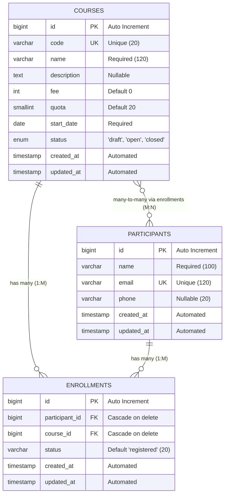

# Entity Relationship Diagram (ERD) — KursusKu Relational Database

Dokumentasi diagram entitas relasional antara **Course**, **Participant**, dan **Enrollment** pada basis data MySQL `kursus_nia`.

## 1. Diagram Relasi Entitas (Mermaid)

## 2. Struktur Konseptual & Atribut

### A. Tabel `courses`
- `id` (BIGINT UNSIGNED, Primary Key, Auto Increment)
- `code` (VARCHAR(20), Unique, Not Null) — Kode unik kursus
- `name` (VARCHAR(120), Not Null) — Nama kursus
- `description` (TEXT, Nullable) — Deskripsi materi kursus
- `fee` (INT UNSIGNED, Default 0) — Biaya kursus dalam Rupiah
- `quota` (SMALLINT UNSIGNED, Default 20) — Kuota peserta
- `start_date` (DATE, Not Null) — Tanggal mulai kelas
- `status` (ENUM('draft','open','closed'), Not Null) — Status kelas
- `created_at` & `updated_at` (TIMESTAMP, Nullable)

### B. Tabel `participants`
- `id` (BIGINT UNSIGNED, Primary Key, Auto Increment)
- `name` (VARCHAR(100), Not Null) — Nama lengkap peserta
- `email` (VARCHAR(120), Unique, Not Null) — Alamat email unik peserta
- `phone` (VARCHAR(20), Nullable) — Nomor telepon peserta
- `created_at` & `updated_at` (TIMESTAMP, Nullable)

### C. Tabel `enrollments` (Pivot / Associative Entity)
- `id` (BIGINT UNSIGNED, Primary Key, Auto Increment)
- `participant_id` (BIGINT UNSIGNED, Foreign Key &rarr; `participants.id`, ON DELETE CASCADE)
- `course_id` (BIGINT UNSIGNED, Foreign Key &rarr; `courses.id`, ON DELETE CASCADE)
- `status` (VARCHAR(20), Default 'registered') — Status pendaftaran
- `created_at` & `updated_at` (TIMESTAMP, Nullable)

## 3. Relasi dan Kardinalitas
1. **Course ke Enrollment (1:M):**
   Satu kursus dapat memiliki banyak pendaftaran (*Course hasMany Enrollment*).
2. **Participant ke Enrollment (1:M):**
   Satu peserta dapat memiliki banyak pendaftaran (*Participant hasMany Enrollment*).
3. **Course ke Participant (M:N):**
   Relasi banyak-ke-banyak antara Course dan Participant dijembatani oleh tabel `enrollments` (*belongsToMany*).

## 4. Constraint & Integritas Referensial
- **Unique Constraint:**
  - `participants.email` bersifat unik secara global.
  - Pasangan `(participant_id, course_id)` pada tabel `enrollments` memiliki **Composite Unique Index**. Satu peserta tidak dapat mendaftar dua kali pada kursus yang sama.
- **Foreign Key Constraints (Referential Integrity):**
  - `participant_id` terhubung ke `participants.id` dengan aturan `ON DELETE CASCADE`.
  - `course_id` terhubung ke `courses.id` dengan aturan `ON DELETE CASCADE`.
  - Jika Course dihapus, seluruh Enrollment yang terkait akan otomatis terhapus tanpa menghapus data Participant.
  - Jika Participant dihapus, seluruh Enrollment yang terkait akan otomatis terhapus tanpa menghapus data Course.
